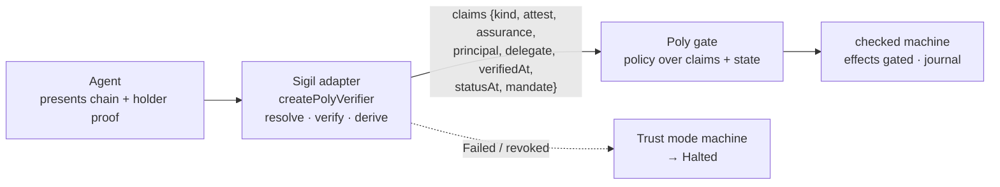

# Poly integration profile — Sigil as the verifier adapter

**Status:** design note, v0 · how a [Poly](https://cognitivefab.com/poly) host consumes Sigil. Requirements in
[`../Requirements/poly-profile.md`](../Requirements/poly-profile.md) (`PP-*`); realizes `R14` and `R16`.

## 1. Why Poly, and what each side does

Poly is a language and runtime for the stateful core of agent-written software: a checker explores every reachable
state of a program before it runs, every outside effect is classed (reversible, compensable, irreversible) and gated
by a signed policy, and a hash-chained journal replays exactly. Poly deliberately does **no identity**. Its proposal
PD5 ("Identity and lineage") puts identity behind a host **verifier adapter**: a function from credentials to a
typed claims record, trusted under one assumption (K11) while Poly checks everything the program does with it.
PD6 ("Freshness and narrowing delegation") asks that adapter for two more things: the age of the evidence behind a
claim, and a `Mandate` whose scope only narrows hop by hop, with parent revocation killing every child.

That is Sigil's present-and-verify, derived assurance, fresh per-hop revocation and monotonic delegation chain,
described independently. The two compose: **Sigil answers who may act and within what bounds; Poly answers whether
the program will still do the wrong thing when every caller is authorized.** Neither replaces the other.



## 2. The adapter (K11 boundary)

[D-PP-1 → PP-1, R14] `createPolyVerifier(deps, opts)` wraps `verifyPresentation`. It takes Sigil's `VerifyDeps`
(the resolver and signature seams, plus the trust policy) and returns a function from a presentation and the
verifier's request to **plain data**. Poly never sees a key, a proof or a DID document; it sees the record and
checks its type. A verified presentation gives `attest: 'Verified'`, `principal` = the root's issuer (the party
authority descends from, the same value `verifyRecord` attributes to) and `delegate` = the holder-bound leaf. A
denial gives `attest: 'Failed'` and the verifier's check-class `reason` and nothing else — minimal disclosure
(AC-12) carries through to the host.

`kind` is always `'Agent'` here: Sigil verifies agents. A person signing with a local key is Poly's own person-key
adapter; a human in Sigil appears as the **co-sign** that lifts assurance (§3), not as a second kind.

## 3. Assurance as a number the policy can read

[D-PP-2 → PP-2, R16] Poly's person-key adapter reports `assurance: 3`. Sigil reports its **derived** rung as the
index on its ladder (`identity` 0, `controller-vouched` 1, `issuer-pinned` 2, `endorsed` 3, `witnessed` 4,
`human-co-signed` 5), with the name beside it. The number comes from `deriveAssurance`, never from the credential's
asserted `assuranceLevel` (TR-1). A host that needs a floor states it in the request's `requiredAssurance`; Sigil
then refuses rather than returning a low number, so a policy never has to guess whether a low rung was intended.
Scales are per adapter: a Poly policy compares a Sigil rung with Sigil thresholds.

## 4. Freshness (PD6 §1)

[D-PP-3 → PP-3, R9] The record carries `verifiedAt` and `statusAt`. The reference verifier resolves every hop's
revocation status **at the moment of verification** (R9: resolution staleness zero), so by default
`statusAt === verifiedAt` and Poly's `statusAge` is simply how long ago the adapter ran. The `Resolver` seam carries
no timestamps, so the adapter cannot discover a cache on its own: a deployment that injects a caching resolver
supplies `opts.statusAt` and thereby states its window (R9) in the same place Poly reads it. The adapter never
invents a time it did not measure.

## 5. Mandate (PD6 §2)

[D-PP-4 → PP-4, R6, R8] `mandateOf(chain)` turns the verified chain into nested mandates, innermost = leaf:

```json
{ "delegator": "did:cid:a1", "delegate": "did:cid:a2", "scope": { "actions": ["read"], "resources": ["res:a"], "audience": ["did:web:vendor"] }, "expires": "2027-01-01T00:00:00Z",
  "parent": { "delegator": "did:cid:a0", "delegate": "did:cid:a1", "scope": { "actions": ["read"], "resources": ["res:a","res:b"], "audience": ["did:web:vendor"] }, "expires": "2027-01-01T00:00:00Z",
    "parent": { "delegator": "did:web:acme", "delegate": "did:cid:a0", "scope": { "actions": ["read","write"], "resources": ["res:a","res:b"], "audience": ["did:web:vendor"] }, "expires": "2027-01-01T00:00:00Z" } } }
```

`scope` is the finite, subset-comparable part of a Sigil capability — exactly what PD6 asks for so that subset is
decidable. `expires` folds `validUntil` and `constraints.notAfter` into one time. Sigil has already proven that every
hop narrows (AC-8) and links to its parent (DC-4) before the record is built, so K12 holds by construction; a host
that re-checks it in Poly's gate (PD6-A4) will find nothing to refuse. Poly reads `delegate` and `principal` side by
side, as PD6 says: the agent acts on behalf of the principal and is never the principal.

## 6. Revocation as a signal (PD5 §3.2)

[D-PP-5 → PP-5, R9, R10] The adapter keeps no state and is called for **every proposed action**, so the per-hop,
fail-closed revocation Sigil already does is exactly what PD6 wants ("on its tenth action as on its first"). The host
maps `attest: 'Failed', reason: 'revoked'` to a `CredentialRevoked(principal)` action on Poly's `Trust` mode
machine, which Poly has proven halts every irreversible effect. Sigil does not push the signal; Poly's own rule that
claims are supplied per step makes polling the natural shape.

## 7. The joint test (PD5 §7)

PD5 names the experiment it wants from an identity partner: *their identity layer as the verifier adapter, Poly's
refund example as the program, and one injected revocation.* With this profile that is:

1. **Program:** Poly's `examples/expense-approval`, unchanged. Its property is "the approver is never the submitter".
2. **Verifier:** `createPolyVerifier` over a live Archon node. `alice` and `bob` become two Sigil agents, each with a
   VRC and an AAC from their controller; the adapter's `principal` is what the program compares.
3. **Revocation:** revoke the approver's AAC mid-run (a `delete` on the credential's DID). The next adapter call is
   `Failed` / `revoked`; the host dispatches `CredentialRevoked`; the `Trust` machine halts; the check has already
   proved `Halted` admits no irreversible effect.
4. **Evidence:** the Poly ledger head countersigned and anchored as an engagement record
   ([`engagement.md`](engagement.md)), so a third party verifies the run without trusting the host.

Nothing in Poly's program, policy or certificate changes. Everything new is host code at the K11 boundary, which is
where Poly says it belongs.

## 8. Open questions

- **Numeric scope bounds.** PD6's example mandate carries an amount ceiling. Sigil's `Capability` has no numeric
  field bounds; `constraints` would need a typed, ordered extension (and the attenuation rule a `≤` case) before an
  amount can ride a Sigil chain. Tracked against `AC-4`'s scope vocabulary.
- **Whose clock.** PD6 asks whose clock computes ages. The adapter uses the request's clock (`req.now`) when given, so
  the host can supply a trusted one; otherwise the adapter's own.
- **Persons.** Whether a co-signing principal should surface as a second claims record of `kind: 'Person'` rather
  than as a rung, so Poly policies can name the human directly.

## Design points

- `[D-PP-1 → PP-1, R14]` §2 — the adapter: Sigil does the cryptography, Poly gets typed data (K11).
- `[D-PP-2 → PP-2, R16]` §3 — derived assurance as a ladder index, floor enforced by the request.
- `[D-PP-3 → PP-3, R9]` §4 — `verifiedAt` / `statusAt`; fresh by default, caching resolvers state their window.
- `[D-PP-4 → PP-4, R6, R8]` §5 — the verified chain as nested mandates; K12 by construction.
- `[D-PP-5 → PP-5, R9, R10]` §6 — stateless per-action calls; `revoked` → `CredentialRevoked`.
